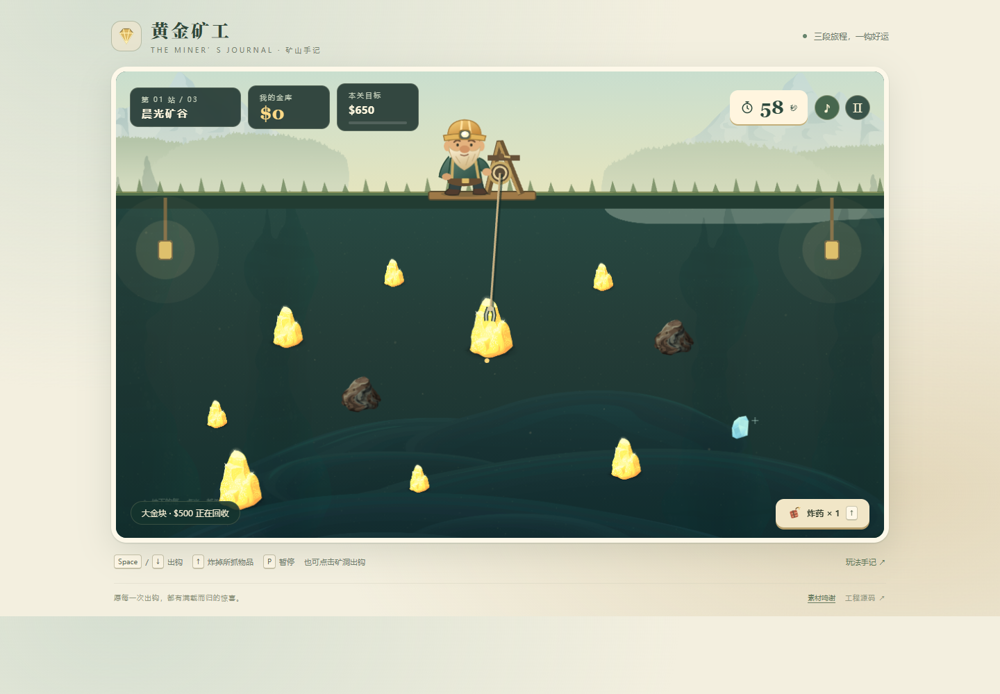

# 黄金矿工 · 矿山手记

一个绘本风格的经典黄金矿工浏览器游戏。瞄准摆动的钩爪，在时间耗尽前带回黄金和钻石，途经补给铺，完成三段矿山旅程。



- **在线游玩**：[icecream863.github.io/gold-miner-storybook](https://icecream863.github.io/gold-miner-storybook/)
- **完整 AI 协作记录**：[在线阅读与下载](https://icecream863.github.io/gold-miner-storybook/session/)，源码中的导出位于 `public/session/`。
- **素材来源**：[完整清单](docs/ASSETS.md)
- **验证记录**：[测试与验收](docs/VERIFICATION.md)
- **操作演示**：[正常速度录像](https://icecream863.github.io/gold-miner-storybook/demo.webm)
- **提交材料汇总**：[SUBMISSION.md](docs/SUBMISSION.md)

## 操作

| 操作 | 键盘 | 鼠标 / 触屏 |
| --- | --- | --- |
| 出钩 | 空格 / ↓ | 点击矿洞 |
| 炸掉所抓物品 | ↑ | 炸药按钮 |
| 暂停 / 继续 | P / Esc | 暂停 / 继续按钮 |
| 静音 | — | 音符按钮 |

每关 60 秒。物品完整回收到绞盘才入账；倒计时结束时检查金库是否达到累计目标。黄金越大越重，钻石价值高、回收快，石头价值低且回收慢。炸药只能用于已经抓住的物品，销毁后不会获得金钱。

金钱跨关累计，商店购买会实际扣钱。力量药水提升下一关的载物回收速度 50%，炸药每次补充一枚。每件商品每间商店限购一次。失败重试会恢复本关入口的钱、炸药和增益，重新开始整局会恢复初始状态。

## 本地运行

需要 Node.js 22.18+，推荐 Node.js 24。

```bash
npm ci
npm run dev
```

```bash
npm run typecheck
npm test
npm run build
npm run preview
```

开发入口默认是 `http://127.0.0.1:5173/`；生产构建位于 `dist/`。运行游戏不需要后端、账号、API 密钥或外部素材服务。构建中的相对资源路径支持 GitHub Pages 仓库子路径。

## 技术实现

固定使用 TypeScript 5.9.3、Phaser 3.90.0、Vite 8.3.4。

- `src/core/model.ts`：纯玩法模型，维护钩爪、碰撞、计时、金钱、商店和关卡入口快照。
- `src/main.ts`：Phaser 场景、DOM 界面与输入，读取模型状态并播放反馈。
- `src/audio.ts`：用户操作后解锁的 Web Audio 音效；音频不可用不会阻断玩法。
- `tests/model.test.ts`：规则边界、30/60/144Hz 一致性和真实三关路线检查。

钩尖上一位置到当前位置执行线段扫掠，与物品圆形碰撞区域相交后选择最早接触者。绳索本身不参与抓取。物品抓取后立即标记为已取，只有回收到绞盘才能计分。运动和计时使用同一有效游戏时间。

页面隐藏或失焦会暂停；返回后需要主动继续。支持窗口按比例缩放与基本触控，手机推荐横屏。正式浏览器验证范围及尚未验证的设备详见验收记录。

## AI 协作与记录

本项目使用 AI 协助需求分析、实现、调试、素材筛选和验证。完整记录按原顺序导出用户输入、助手回复和工具记录，保留失败尝试与截断标记；导出政策、时点和来源摘要位于 `public/session/manifest.json`。

重新导出：

```bash
npm run session:export -- <本次对话原始JSONL的绝对路径>
```

平台内部元数据与未公开推理不属于可导出的人机对话；凭据、本机用户名目录和 Git 配置邮箱会脱敏。原始记录保留在本机。测试报告不把模型检查、浏览器自动操作与人类试玩体验混为一谈。

## 部署

GitHub Actions 在推送 `main` 后执行安装、类型检查、规则测试和构建，通过后发布 `dist/` 到 GitHub Pages。公开地址与本仓库对应。

## 许可与说明

项目自编代码与原创矢量插画采用 [MIT 许可](LICENSE)。第三方图片按 [各自来源及许可](docs/ASSETS.md) 使用，不受本项目代码许可替代。

本项目为学习及招聘测试中的经典玩法复刻，与原版游戏及其权利人没有关联。
