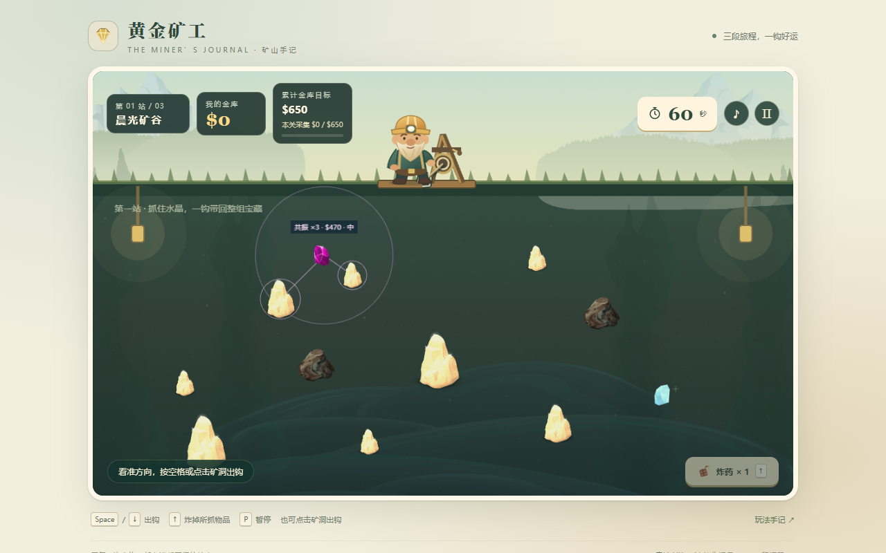
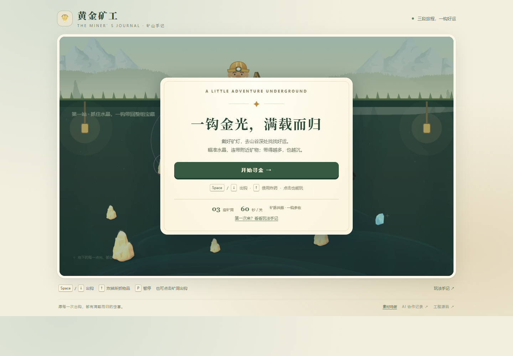
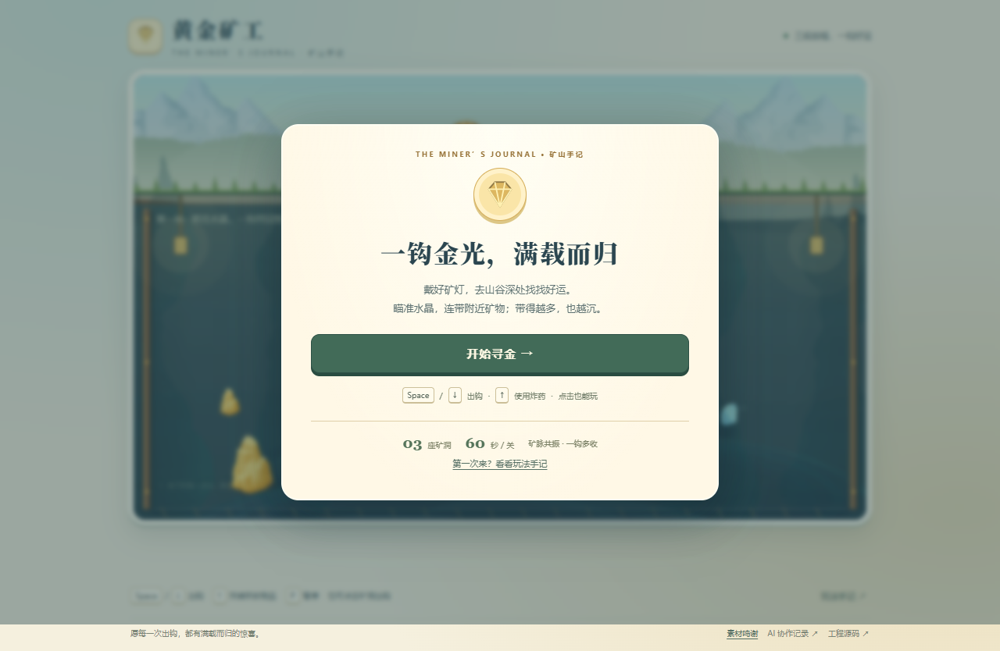

# 第五阶段：美术与 UI 品质

2026-10-17，本地生产版本。没有推送、部署或公开更新 Session。本阶段收尾后停止，不自动进入第六阶段。

## 真实问题与处理顺序

先阅读场景绘制、样式、资源、素材清单与现有验收，再运行并查看实际画面。旧矿洞偏暗，岩壁与岩层不清楚；黄金高光接近白色；底部状态条会遮低处矿物。五商品列表较长，首页、商店与结算的层级和间距也不一致。

先完成并实际查看主游戏场景，再修改其他界面。复用现有 Glitch 系列资源，用代码补充简单环境；没有重新生成整套素材，也没有更换资源系统。

| 区域 | 最终变化 |
| --- | --- |
| 主场景 | 蓝青矿洞与暖色地表形成区分，增加宽岩层、地表断面、两侧木支架和底部轨道；装饰位于采集物后方 |
| 矿物 | 原矿石按亮度映射为金色、棕色阴影与浅金高光，保留透明轮廓；石头保持灰褐，钻石青蓝，水晶紫粉并沿用连接预览 |
| 矿工与机械 | 原创 SVG 调整为蓝青工装与金色矿帽，统一圆润描边；绳索、钩爪、绞盘采用一致的墨色与黄铜色。沿用第四阶段已有动作与生命周期 |
| HUD 与操作 | 钱包、目标、采集要求和倒计时重新排版；操作条移出矿洞，避免遮挡深处矿物。竖屏 HUD 位于画布外，布局变化后刷新输入缩放测量 |
| 主菜单与暂停 | 统一纸张、标题、主按钮、操作说明、短转场；菜单以水晶机制说明和三关信息建立入口层级 |
| 商店 | 五枚已有 SVG 图标统一底板；桌面三列卡片，竖屏单列；价格常显，已购、余额不足与可购买状态区分，保留购买后的滚动位置 |
| 结算 | 过关、失败与最终通关分别使用状态标志和文案，同时显示钱包及本关采集要求 |
| 交互 | 按钮按下反馈与 180ms 弹窗进入动画；商店重绘不重新播放进入动画。低动态偏好关闭界面动画，原生滚动仍可用 |

界面修改没有参与碰撞、捕获、发放或得分。没有新增规则回调、物理系统或商品框架。

## 新旧画面对比

主场景来自相同 1280×800 视口和第一关初始布局。整页截图可能包含视口外页脚，不把截图总高度当作矿洞面积。

| 修改前 | 修改后 |
| --- | --- |
|  |  |

旧主菜单来自此前保留的较大窗口截图，只用于比较信息与布局，不进行尺寸对照。

| 修改前 | 修改后 |
| --- | --- |
|  |  |
|  |  |

旧商店仍显示历史 $180 价格；$80 的价格修正属于第三阶段复查，不能算作美术阶段的经济修改。详情见 [商店记录](STAGE3-SHOP.md)。

另见 [手机竖屏](screenshots/stage5-portrait.png)、[手机横屏](screenshots/stage5-landscape.png)、[失败](screenshots/stage5-failed.png) 与 [最终通关](screenshots/stage5-complete.png)。

## 素材与体积

背景与矿物继续使用 Tiny Speck / Glitch 资源，经 ThirdPartyNinjas 转换为 PNG。已重新查看官方 [Locations](https://github.com/tinyspeck/glitch-locations/blob/master/README.md) 和 [Items](https://github.com/tinyspeck/glitch-items/blob/master/README.md) 的 CC0 许可说明，随工程保存副本；logo 与商标不在许可范围内，本项目未使用。旧官方页面失效的边界与全部来源见 [ASSETS.md](ASSETS.md)。

九张第三方 PNG 的 SHA-256 全部与清单一致，总大小 **465650 字节（约 455 KiB）**，单张最大宽 2020、最大高 1752。没有新增运行时位图或外部字体。黄金 256×256、水晶 80×68 的派生纹理只在加载时产生；岩层与纹理颗粒在创建静态背景时绘制，不逐帧重建。原始 PNG 不被覆盖。详见 [素材与规则哈希检查](verification/stage5-assets.log)。

本阶段最初保存的哈希与当前比较：`core/model.ts`、`audio.ts`、`presentation.ts` 均一致。`core/shop.ts` 不一致，因为随后第三阶段复查将增幅价格 $180 改为 $80；该修改及其专项验收已单独记录，不能声称本阶段所有文件哈希都未变。

## 修改文件

- `src/art.ts`：配色、保留 alpha 的黄金亮度映射、静态岩层绘制；不依赖模型。
- `src/main.ts`：场景绘制与调色纹理、HUD／菜单／商店／结算结构、操作条位置与布局后的缩放刷新。
- `src/style.css`、`src/tokens.css`：统一配色、组件状态、断点、视口弹窗和低动态样式。
- `public/assets/art/miner-original.svg`：角色配色和描边，保持形状与 viewBox。
- `tests/art.test.ts`：黄金透明度、明暗与高光映射。
- `tests/browser/visual.spec.mjs`：桌面及模拟手机几何遮挡、操作条、弹窗、低动态和失败重试。
- `scripts/browser-playthrough.mjs`：最终通关截图完成有限 CSS 转场，避免截到半透明中间帧；不改变实际游戏动画。
- `docs/ASSETS.md`、`docs/licenses/Glitch-*-README.md`、本记录、截图及验收输出：来源、对比与证据。

## 验收与边界

类型检查、生产构建与 **56/56 单元及规则测试通过**；完整生产 Edge 浏览器回归 **19/19 一次运行全部通过**（约 5.8 分钟）。原始输出：[stage5-browser.log](verification/stage5-browser.log)。

覆盖：完整三关及通关重开、五道具双击购买与下一关实际执行、普通及共振抓取、按重量回收和单次入账、炸毁、超时重试、视觉及音效暂停恢复、鼠标／键盘／原生触屏、工具栏焦点、长帧、图片阻断后的重试、低动态与音频不可用降级。新增布局用例检查 1280×800、1366×768、1280×720、390×844、320×568、844×390：操作条位于画布外且在视口内，HUD 不覆盖初始矿物区域，页面无水平溢出；手机菜单及失败重试可访问。测试检查不等于所有移动路径或设备均已覆盖。

黄金映射单测检查透明轮廓、亮度顺序和高光色差；不是仅比较实现内部常量。新增布局专项此前独立 **2/2** 通过的记录见 [stage5-layout.log](verification/stage5-layout.log)，它们也已包含在本次 19 个场景中，不重复计数。本轮没有失败项；不把构建或一轮通过描述为无 Bug。

截图复查发现首次最终通关图捕获了 180ms 转场的半透明中间帧。只在验收截图中令有限 CSS 动画完成，不调整生产表现或规则；受影响的完整三关用例再次 **1/1** 通过（约 1.5 分钟），见 [stage5-screenshot-final.log](verification/stage5-screenshot-final.log)，并替换为转场完成后的通关图。这是同一用例的专项复验，不计为第 20 个不同场景。

正常速度的 UI 操作已实际打开主菜单，按开始、空格出钩，回收到 $100；随后按 P 暂停。间隔后检查仍为 $100、48 秒，暂停界面可读。此操作没有安装虚拟时钟、读取瞄准状态或直接修改模型；它只是短时 Agent 试玩，不代替第六阶段要求的从头到尾主观试玩。

未验证真实手机、Safari、微信浏览器和人耳听感。手机竖屏虽可操作，但矿物仍较小，主要推荐横屏。系统字体在不同设备上会有字形差异。短时桌面采样不证明长期性能。本阶段没有增加背景音乐、复杂角色骨骼动画或额外场景资源包；演示录像、完整 Session 与发布工作留给最终交付阶段。
